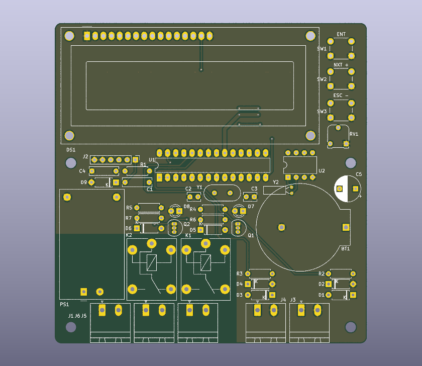

# Solar Pool Heater Controller

[Português (Brasil)](README.pt-BR.md)

Designed by Mario Pin (PU2PTU). The controller compares water temperatures at the pool and the solar collector and switches the heating pump according to the temperature difference. A separate relay runs the filtration pump on a schedule. Later firmware revisions add manual pump modes, scheduled heating-loop circulation, and a serial Bluetooth interface.

## Hardware

| Board | Controller and clock | Firmware |
| --- | --- | --- |
| [MPS01 1.0](hardware/MPS01/1.0) | ATmega328P at 16 MHz and DS1307 | Historical PCB. This revision reverses SDA and SCL. |
| [MPS01 1.1](hardware/MPS01/1.1) | ATmega328P at 16 MHz and DS1307 | Target board for the archived AVR firmware. Corrected I²C routing. |
| [MPS02 2.0](hardware/MPS02/2.0) | ESP32-WROOM-32D and DS3231M | KiCad design only. This revision stayed at the design stage. |

The MPS01 1.1 is the target for all 13 firmware versions. The MPS01 uses two 10 kΩ NTC probes, a parallel 16×2 LCD, three push buttons and separate relays for the heating and filtration pumps. The hardware guide includes the Arduino pinout, connector assignments and the sensor-label discrepancy between the MPS01 schematics and sketches. [Hardware and assembly guide](docs/hardware.md) · [Original parts list](docs/BOM.xlsx)

## Firmware

Each version is recorded in a Git commit with the same Arduino sketch path, `firmware/PoolHeater/PoolHeater.ino`. Version names follow the original sketch folders. The default branch carries the latest archived sketch, `v0.3.0_BT`. The Bluetooth release is experimental and has a known filter-mode persistence issue.

- [Arduino setup, first boot and operating guide](docs/firmware.md)
- [Changes by version](CHANGELOG.md)
- [GitHub releases](https://github.com/mariopin80/Aquecedor_piscina/releases)
- [MPS01 PCB test sketch](examples/teste_PCB)

Install **Arduino AVR Boards** and **LiquidCrystal** in Arduino IDE. The archived copies of **BigNums2x2** and **RTC** are in [libraries/](libraries), with their original license files. Copy both library folders into the sketchbook's `libraries` folder and open the sketch. Use **Arduino Uno** as the build target for the ATmega328P at 16 MHz.

For initial setup, run the controller on the bench with pump loads disconnected. Set the clock, select each pump mode and verify the displayed temperatures before configuring automatic operation. See the operating guide for EEPROM initialization on a blank MCU.
