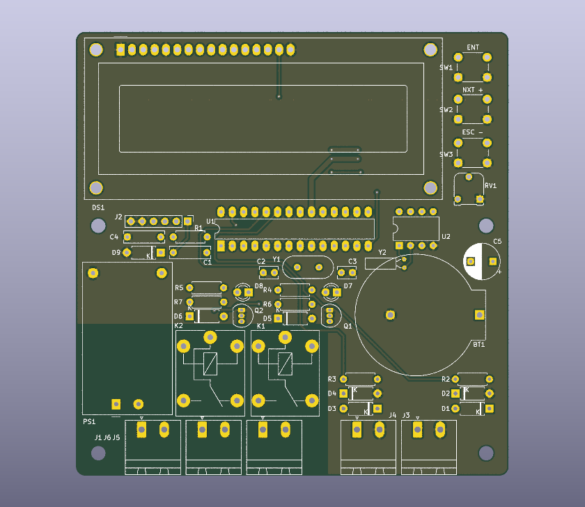

# Controlador de aquecimento solar de piscina

[English](README.md)

Projeto de Mario Pin (PU2PTU). O controlador compara as temperaturas da água da piscina e do coletor solar e aciona a bomba de aquecimento conforme a diferença entre elas. Um segundo relé aciona a bomba de filtragem por horário. As versões posteriores acrescentam seleção manual do estado das bombas, circulação programada do circuito de aquecimento e uma interface serial Bluetooth.

## Hardware

| Placa | Controlador e relógio | Firmware |
| --- | --- | --- |
| [MPS01 1.0](hardware/MPS01/1.0) | ATmega328P a 16 MHz e DS1307 | PCB histórica. Esta revisão inverte SDA e SCL. |
| [MPS01 1.1](hardware/MPS01/1.1) | ATmega328P a 16 MHz e DS1307 | Placa-alvo dos firmwares AVR do acervo. Roteamento I²C corrigido. |
| [MPS02 2.0](hardware/MPS02/2.0) | ESP32-WROOM-32D e DS3231M | Projeto de hardware em KiCad. Esta revisão ficou na etapa de projeto. |

A MPS01 1.1 é a placa-alvo das 13 versões históricas e da beta 0.4.0. A MPS01 usa dois sensores NTC de 10 kΩ, LCD paralelo de 16×2, três botões e relés separados para aquecimento e filtragem. O guia mostra a pinagem Arduino, a função dos conectores e a divergência na identificação dos sensores entre o esquema e o firmware da MPS01. [Guia de hardware e montagem](docs/hardware.pt-BR.md) · [Lista original de componentes](docs/BOM.xlsx)

## Firmware

A `v0.4.0-beta` traz navegação responsiva pelos três botões, diagnóstico de sondas e RTC, validação dos ajustes na EEPROM e um protocolo UART Bluetooth opcional para aplicativo. A pinagem da MPS01 1.1 continua a mesma. Baixe o ZIP completo do código-fonte para compilar a beta.

- [Guia de instalação e operação da beta](docs/firmware.pt-BR.md)
- [Protocolo Bluetooth v1](docs/bluetooth.md)
- [Análise do firmware e comparação com equipamentos comerciais](docs/firmware-review.pt-BR.md)
- [Alterações por versão](CHANGELOG.pt-BR.md)
- [Releases no GitHub](https://github.com/mariopin80/Aquecedor_piscina/releases)
- [Sketch de teste da PCB MPS01](examples/teste_PCB)

Os releases históricos contêm os sketches originais em `firmware/PoolHeater/PoolHeater.ino`. A beta usa o mesmo sketch principal com os arquivos auxiliares na pasta.
